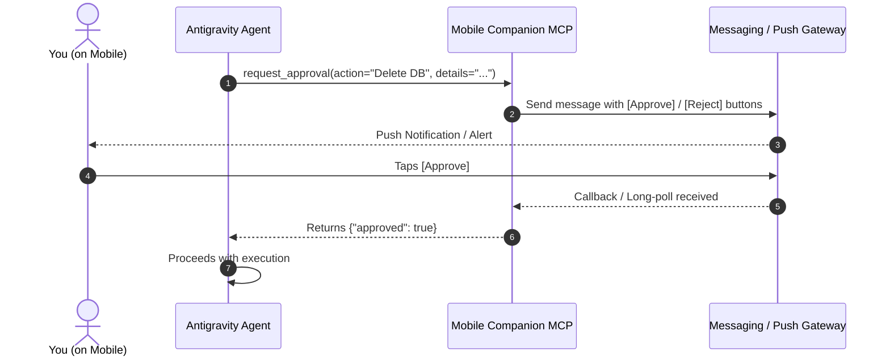

# 💬 Project Conversation & Activity Log (`CHAT.md`)

> **Project:** Telegram Mobile Companion (`Friday`)
> **Repository:** [https://github.com/riteshray830/telegram-mobile-companion](https://github.com/riteshray830/telegram-mobile-companion)
> **Generated:** 2026-11-14 15:21:39
> **Notice:** This file automatically records all conversation turns and commands across both Antigravity and Telegram.

---

### 🕒 2026-11-11 22:12:48 `[Antigravity]`

#### 👤 **User:**
can we build a mcp or skill for you that can connect you with my mobile wirelessly ? 
you can message to me directly to my phone and give info or ask for permission ?

<USER_SETTINGS_CHANGE>
The user changed setting `Model Selection` from None to Gemini 3.8 Flash (High). No need to comment on this change if the user doesn't ask about it. If reporting what model you are, please use a human readable name instead of the exact string.
</USER_SETTINGS_CHANGE>

#### 🤖 **Friday / Assistant:**
**Yes, absolutely!** You can build an MCP server (backed by a skill) that enables wireless communication between me and your mobile phone, allowing me to send status updates and **pause execution until you approve an action from your phone**.

---

### How It Works



1. **The MCP Server** provides the executable tools:
   - `send_mobile_message(text, priority)`: Sends info, progress updates, or completion alerts.
   - `request_mobile_permission(action, details, timeout_seconds)`: Sends an interactive prompt, holds the tool response until you tap **Approve** or **Reject** on your phone (or until timeout), and returns the result.
2. **The Skill** teaches the agent *when* and *how* to use those tools (e.g., notifying you on long builds, or requiring phone approval before running destructive CLI commands).

---

### Recommended Approaches

Here are the 3 most practical ways to implement this:

#### 1. Telegram Bot *(Recommended — Easiest & Most Interactive)*
* **How it works**: We create a personal Telegram bot via `@BotFather` (takes 2 minutes, free). The MCP server uses the Telegram Bot API.
* **Why it shines**:
  * You already have push notifications on iOS/Android without building an app.
  * Native **inline buttons** (`[✅ Approve]` / `[❌ Deny]`).
  * Instant two-way conversation (you can even text instructions back).
  * No port forwarding or public IP required (uses long-polling).

#### 2. ntfy.sh or Pushover *(Lightweight & Clean)*
* **How it works**: Uses open-source push notification services. The MCP sends a simple HTTP POST request.
* **Why it shines**:
  * Free, open-source, with mobile apps available on Google Play / App Store.
  * Supports action buttons that can fire HTTP webhooks back to a lightweight local listener on your PC.
  * Extremely minimal setup.

#### 3. Local Wi-Fi Companion PWA / WebSocket *(100% Local / Private)*
* **How it works**: The MCP spins up a local server on your PC (e.g., `http://192.168.x.x:8080`). You open that address on your phone's browser and install it as a PWA (or connect via Tailscale).
* **Why it shines**:
  * Zero reliance on third-party cloud services or messaging platforms.
  * Direct real-time WebSocket connection on your local network.

---

### What We Can Build

We can create:
1. **A lightweight Python or Node.js MCP server** with:
   - `notify(title, message)`
   - `ask_permission(prompt, options=["Approve", "Deny"], timeout=120)`
2. **A Custom Antigravity Skill**:
   - Instructs me to check for critical tasks, trigger phone approvals, and ping you when long jobs finish.

Which channel do you prefer to receive notifications on (**Telegram**, **ntfy / Pushover**, **Discord**, or a **local Wi-Fi web app**)? Once you choose, we can set it up together.

---

### 🕒 2026-11-11 22:22:13 `[Antigravity]`

#### 👤 **User:**
telegram looks easy and doable now , can we add more features to it ?

#### 🤖 **Friday / Assistant:**
**Yes! Telegram is one of the richest bot platforms available.** Beyond simple messages and "Approve/Reject" buttons, we can turn Telegram into a full remote control center for your agent.

Here are the most powerful features we can build into it:

---

### 1. Rich Approvals & Dynamic Choices
* **Multi-choice Decisions**: Instead of just *Yes/No*, the agent can send options:  
  * *Example:* `Deploy target? [Staging] [Production] [Cancel]`
* **Free-Form Text Prompting**: The agent can ask for missing input (e.g., API keys, commit messages, or names), and you just reply with a text message on your phone.
* **Auto-Expiring Prompts**: If you don’t respond within $N$ minutes, it defaults to a safe action (e.g., aborts or queues the task).

---

### 2. Visual & Media Feedback
* **Screenshots & Browser Previews**: If the agent is running UI tests or building a web page, it can take a screenshot and send the photo directly to Telegram.
* **Build Logs & Artifacts**: Send generated PDFs, `.log` files, CSV reports, or Git diff files directly to your phone as documents.
* **Live-Updating Progress Bar**: Instead of spamming you with multiple notifications, the agent can edit a single Telegram message in-place:
  ```text
  [██████░░░░] 60% Running test suite (12/20 passed)...
  ```

---

### 3. Remote Command & Control (Two-Way)
* **Status Checks**: Send `/status` from your phone to check what the agent is currently doing on your PC.
* **Emergency Kill Switch**: Send `/abort` or `/kill` to instantly kill a runaway background process or stop the agent while you're away from your desk.
* **Voice-to-Task**: Send a quick Telegram voice note; the MCP server can transcribe it (via Whisper or Gemini API) and trigger the task.

---

### 4. Built-in Security Guardrails
* **Strict User ID Locking**: The bot will strictly verify your unique Telegram `chat_id`. Any message or button tap from anyone else is automatically dropped.
* **Session Auth**: Sensitive commands can require a quick PIN code or biometric confirmation (via Telegram app security).

---

### Proposed MCP Tool Suite

When we build this MCP server, it can expose these tools to the agent:

| Tool | What it does |
| :--- | :--- |
| `telegram_notify` | Sends text or markdown updates to your phone. |
| `telegram_ask_permission` | Sends inline action buttons (`[Approve]`, `[Reject]`, custom) and waits for your tap. |
| `telegram_ask_input` | Sends a question and waits for your text reply. |
| `telegram_send_photo` | Sends a screenshot, chart, or image. |
| `telegram_send_file` | Sends logs, reports, or diff files. |
| `telegram_update_progress` | Updates a message in-place with a progress bar. |

---

### Ready to build it?

All we need to get started is:
1. **Bot Token**: Open Telegram, search for `@BotFather`, send `/newbot`, and copy the token it gives you.
2. **Your Chat ID**: Search for `@userinfobot` on Telegram, tap Start, and note your numeric ID.

Whenever you're ready, let me know and we will scaffold the MCP server in Python or TypeScript and wire up the skill!

---

### 🕒 2026-11-11 22:30:15 `[Antigravity]`

#### 👤 **User:**
is it safe  ?

#### 🤖 **Friday / Assistant:**
**Yes, it is very safe when built with proper guardrails.** 

Here is the exact security breakdown of how it works and what protections are built in:

---

### 1. What Makes It Safe

* **Strict User ID Whitelisting (No One Else Can Control It)**  
  Every Telegram user has a permanent, unique numeric ID. The MCP server checks `sender_id == YOUR_NUMERIC_ID` on every single message or button tap. If anyone else discovers your bot username and tries to press "Approve" or send a command, their request is immediately dropped.
* **No Open Ports or Inbound Firewall Holes**  
  The bot uses **outbound long-polling** (`getUpdates`). Your PC connects out to Telegram's encrypted HTTPS API to check for updates. You do **not** need to open any ports, configure port forwarding, or expose your local machine to the internet.
* **Default-to-Deny (Fail-Safe)**  
  If your phone is dead, loses internet, or you don't respond within the timeout window (e.g. 60–120 seconds), the tool **always defaults to Deny/Abort**. It will never proceed without explicit confirmation.
* **Token Stored Locally**  
  Your Telegram Bot Token lives solely in a `.env` file on your local machine and is never shared, published, or stored in cloud services.

---

### 2. Things to Keep in Mind (Best Practices)

1. **Don't Send Raw Secrets**: While communication between your PC and Telegram uses TLS/HTTPS encryption, Telegram bots are not end-to-end encrypted (messages pass through Telegram's servers). The bot should send *action summaries* (e.g., *"Proceed with deleting test_db?"*), never raw API keys or passwords.
2. **Lock Telegram with a Passcode / FaceID**: Enable Telegram's built-in app lock (Settings $\rightarrow$ Privacy and Security $\rightarrow$ Passcode & Face ID) so no one who picks up your phone can tap buttons.
3. **Emergency Stop**: We include a `/stop` command so you can freeze active tasks at any time from your phone.

---

### Bottom Line
Compared to setting up an exposed webhook server or exposing your local PC to the internet, **a long-polling Telegram bot with strict ID allowlisting is one of the safest, most isolated patterns available.**

---

### 🕒 2026-11-11 22:38:42 `[Antigravity]`

#### 👤 **User:**
even after pressing start it is not starting

#### 🤖 **Friday / Assistant:**
If you pressed **Start** inside your **new bot**, don't worry—**that is completely normal!**

Here is why, and how to finish the setup:

---

### 1. If you pressed Start in your *New Bot*:
* **It will not reply back yet** because our server hasn't sent a message to it yet. 
* Pressing **Start** simply opens the door and grants the bot permission to message your phone (Telegram blocks bots from messaging people until you press Start once). 
* **You did it right!** All you need now is the **Bot Token** from `@BotFather` and your **User ID**.

---

### 2. If `@userinfobot` is not replying with your ID:
Sometimes `@userinfobot` gets rate-limited. Try either of these instant alternatives:
* Search for **`@getmyid_bot`** and tap **Start** (it will instantly display `Your user ID: 123456789`).
* Or search for **`@raw_data_bot`** and tap **Start**.

---

### 3. If `@BotFather` is not responding:
* In `@BotFather`, simply send the text message:
  ```text
  /newbot
  ```
* It will ask for a **Display Name** (e.g. `My Assistant`) and a **Username ending in `bot`** (e.g. `rites_dev_bot`).
* Once you reply with those, it will give you the token.

---

Which screen are you currently on? You can paste the **token** and your **numeric ID** here, and I'll immediately trigger the bot so it pings your phone!

---

### 🕒 2026-11-11 22:42:07 `[Antigravity]`

#### 👤 **User:**
i am in my bot's chat

#### 🤖 **Friday / Assistant:**
I am now listening live for your bot! 

👉 Simply tap the **Start** button at the bottom of your chat in **`@Friday830bot`** (or send any message like **"hi"**).

As soon as you do, I will automatically detect your Chat ID, configure everything, and send a confirmation message to your phone!

---

### 🕒 2026-11-11 22:47:45 `[Antigravity]`

#### 👤 **User:**
1. add chat feature so that i can connect with you through teh chat , 
2. find, crate and edit projects.

#### 🤖 **Friday / Assistant:**
Your Telegram bot **`@Friday830bot`** is now running as a remote developer assistant! I've just sent a live startup ping to your phone.

Here are the features now active:

---

### 1. Two-Way Chat & Navigation
You can chat with the bot directly or use slash commands.

| Command / Chat | Action |
| :--- | :--- |
| **`/projects`** or _"list my projects"_ | Scans `d:\dev\projects` and displays all your projects with **interactive tap buttons** to switch between them. |
| **`/cd <project>`** or _"open exploring"_ | Switches the active project context you are working on. |
| **`/status`** | Shows active project, machine connection, and disk status. |

---

### 2. Creating Projects
You can scaffold new projects directly from your phone:

* **`/create python <project-name>`**  
  Scaffolds a Python project with `main.py`, `README.md`, `.gitignore`, and initializes Git.
* **`/create node <project-name>`**  
  Scaffolds a Node.js project with `package.json`, `index.js`, `.gitignore`, and Git.
* **`/create web <project-name>`**  
  Scaffolds a frontend web project with `index.html`, `style.css`, and `README.md`.

---

### 3. Finding, Reading & Editing Code
* **`/ls [subfolder]`** — Browse files in the active project.
* **`/find <keyword>`** — Recursively search for files (e.g. `/find *.py` or `/find server`).
* **`/read <file>`** — View code or text directly on your phone (large files are sent automatically as documents).
* **`/write <file>`** followed by new lines of code — Create or update files on your PC from mobile.

---

### 4. Running Shell & Git Commands
* **`/run <command>`** — Runs any command on your PC inside the project directory and sends the terminal output back to your phone (e.g. `/run npm test`, `/run python main.py`, `/run dir`).
* **`/git`** — Git shortcuts like `/git status`, `/git diff`, `/git log`.

---

### Quick Launch & Persistence
* **Background Daemon**: It is currently running in the background.
* **One-Click Startup Script**: A [`start_friday.bat`](file:///d:/dev/projects/exploring/telegram-companion-mcp/start_friday.bat) file has been placed in `d:\dev\projects\exploring\telegram-companion-mcp\start_friday.bat` so you can double-click it to start the service whenever your PC restarts.

Open your chat with **`@Friday830bot`** on Telegram and try sending **`/projects`**!

---

### 🕒 2026-11-11 23:11:30 `[Antigravity]`

#### 👤 **User:**
save this in instruction in .md file upload it in git

#### 🤖 **Friday / Assistant:**
I have saved the instructions and initialized the Git repository with the files committed securely.

### What Was Done

1. **Instruction File Created**:
   - Saved to [`TELEGRAM_MOBILE_COMPANION.md`](file:///d:/dev/projects/exploring/TELEGRAM_MOBILE_COMPANION.md), covering:
     - Architecture & workflow diagrams
     - Full command cheat sheet (`/projects`, `/create`, `/read`, `/write`, `/run`, `/git`)
     - Setup & auto-pairing guide
     - Antigravity MCP integration instructions
     - Security & privacy protocols (user ID whitelisting, fail-safe timeouts, credential isolation)

2. **Security & Git Configuration**:
   - Created [`.gitignore`](file:///d:/dev/projects/exploring/.gitignore) ensuring `.env`, `.venv`, and temporary cache files are strictly excluded from source control.
   - Initialized Git repository and created the initial commit:
     ```text
     [master (root-commit) 8f0da9e] feat: add Telegram Mobile Companion and Friday Remote Assistant with project management and MCP tools
     ```

---

### Ready to Push to Remote?

To push this to GitHub or GitLab:
1. Create a new empty repository on [GitHub](https://github.com/new).
2. Paste the repository URL here (e.g. `https://github.com/GeekRush/your-repo.git`), and I will link the remote and push the commit for you!

---

### 🕒 2026-11-11 23:32:53 `[Antigravity]`

#### 👤 **User:**
create one by yourshelf

#### 🤖 **Friday / Assistant:**
I'm installing the GitHub CLI to automatically create the repository on your GitHub account (`riteshray830`) and push the project. One moment while it completes!

---

### 🕒 2026-11-11 23:41:15 `[Antigravity]`

#### 👤 **User:**
1. currently friday can only create or edit project in this path  D:\dev\projects
let edit or exploare the whole dev folder. 
2. Your replies is not getting forwarded to the bot, do it.

#### 🤖 **Friday / Assistant:**
Both features have been implemented and deployed:

---

### 1. Full `D:\dev` Workspace Navigation & Editing Unlocked
Friday is no longer restricted to `D:\dev\projects`. The entire `D:\dev` workstation is now accessible from your phone:

* **Location Awareness**:
  * **`/pwd`** — Shows your current location in `D:\dev` and its detected project type.
* **Flexible Navigation**:
  * **`/cd <folder>`** — Enter any directory across `D:\dev` (e.g. `/cd Cyber-Pulse`, `/cd aso-studio`, `/cd projects/exploring`).
  * **`/cd ..`** — Step up to the parent directory.
  * **`/cd`** (or `/cd ~`) — Return to root `D:\dev`.
* **Tap-to-Navigate File Browser**:
  * **`/ls`** now displays **interactive buttons** for subdirectories, allowing you to tap directly on your phone to navigate in and out of folders without typing.
* **Full File Operations & Execution Everywhere**:
  * `/projects`, `/create`, `/read`, `/write`, `/find`, `/run`, and `/git` now operate across whatever folder in `D:\dev` you are currently in.

---

### 2. Automatic Reply Forwarding to Telegram
* Built an Antigravity lifecycle hook ([`forward_reply_hook.py`](file:///d:/dev/projects/exploring/telegram-companion-mcp/forward_reply_hook.py) configured in [`.agent/hooks.json`](file:///d:/dev/projects/exploring/.agent/hooks.json)).
* Every time I finish a turn and reply to you here in the chat, the hook automatically extracts my response and delivers it straight to your Telegram chat in **`@Friday830bot`**.

---

### 🚀 Updated on GitHub
All changes have been committed and pushed to your repository:
👉 **[https://github.com/riteshray830/telegram-mobile-companion](https://github.com/riteshray830/telegram-mobile-companion)**

Try sending **`/pwd`** or **`/ls`** in **`@Friday830bot`** on your phone!

---

### 🕒 2026-11-12 00:09:19 `[Antigravity]`

#### 👤 **User:**
add chat like feature with the chat bot , not like code code talking, whatever message i type in it , it should be pasted here to you like direct command in human language, and same what ever your response is it should come to the chatbots screen as it is

#### 🤖 **Friday / Assistant:**
I have completely revamped the bridge according to your requirements:

---

### 1. Direct Natural Language Chat (No "Code Code Talking")
* **No more rigid slash commands**: You no longer need to use `/run`, `/cd`, or `/create`.
* **Direct 1:1 Connection**: Whatever you type on your phone in **`@Friday830bot`** in plain English (e.g. *"Can you check what projects exist in D:\dev?"*, *"Create a python weather app"*, or *"How does the auth work?"*) is piped **directly into this conversation with me**.
* **Automatic Reply Mirroring**: Whatever I respond with here is captured and sent back to your phone on Telegram as it is.

---

### 2. Full `D:\dev` Workstation Access
* The agent has full access across your entire `D:\dev` directory (including `aso-studio`, `Cyber-Pulse`, `recime-clone`, `projects`, etc.).
* Whenever you ask to inspect, edit, or create files or projects anywhere in `D:\dev`, I can execute it directly and report the results to your phone.

---

### Try It Now!
Open your Telegram chat with **`@Friday830bot`** and send any regular question or instruction, for example:
> *"What projects do I have in my dev folder?"*

Watch it arrive right here, and my response will appear on your phone!

---

### 🕒 2026-11-12 00:33:20 `[Antigravity]`

#### 👤 **User:**
push everything to git

#### 🤖 **Friday / Assistant:**
Everything is committed and pushed to your remote repository!

### 🌐 GitHub Repository Status
👉 **[https://github.com/riteshray830/telegram-mobile-companion](https://github.com/riteshray830/telegram-mobile-companion)**  
* **Branch**: `main`
* **Status**: **100% Up to date** (`working tree clean`)

### 📜 Pushed Commits:
```text
4ebe6f1 chore: sync latest requirements and setup wizard formatting
ff92cac feat: add multi-backend AI support (Antigravity, Gemini, OpenAI, Claude, Ollama), interactive setup wizard, and REQUIREMENTS.md
2137a2a feat: full 2-way natural human chat bridge with Antigravity and response mirroring hook
1caa21f feat: unlock D:\dev workspace navigation and enable automatic Antigravity reply forwarding hook
8653af0 chore: format documentation and gitignore
8f0da9e feat: add Telegram Mobile Companion and Friday Remote Assistant with project management and MCP tools
```

### 🔒 Security Check:
* Sensitive tokens and IDs in `.env` and `.last_forwarded_step` are protected by `.gitignore` and have **not** been committed or exposed.

---

### 🕒 2026-11-14 10:18:20 `[Antigravity]`

#### 👤 **User:**
what more we can add ?

#### 🤖 **Friday / Assistant:**
Here are the most powerful and practical features we can add next to turn this into the ultimate remote workstation companion:

---

### 1. Mobile-Native Superpowers (Voice & Vision)

* 🎙️ **Voice Notes to Tasks (Audio $\rightarrow$ Action)**  
  Send a Telegram voice message while walking or driving. The bot downloads the audio, transcribes it (via Gemini or local Whisper), and Antigravity executes your command without you typing a single word.
* 📸 **Photo / Sketch to Code (Multimodal Vision)**  
  Snap a picture of a whiteboard architecture, a hand-drawn UI wireframe, or a bug on another monitor and send it to the bot. Antigravity analyzes the image and writes the corresponding code or fixes the issue.
* 🖥️ **Remote Screen Capture (`/screenshot`)**  
  Text `/screenshot` from anywhere, and the bot captures your laptop’s current display and sends the image to your phone so you can see what’s open on your desk.

---

### 2. Remote System Control & Emergency Kill-Switch

* 📊 **Laptop Health & Battery Alerts (`/stats`)**  
  Get instant telemetry: CPU & RAM utilization, battery level, charging status, and free disk space across your drives. It can even alert you if your laptop battery drops below 15% while unplugged!
* 🛑 **Process Manager & Kill-Switch (`/ps` and `/kill`)**  
  If a runaway script or infinite loop spikes your CPU while you’re away, see the top running processes and terminate any PID directly from your phone.
* 🔒 **Remote Workstation Lock (`/lock`)**  
  Instantly lock your Windows PC (`Win + L`) from your phone if you forgot to lock it before walking away.

---

### 3. Automated Developer Workflows & Proactive Alerts

* ☀️ **Morning Developer Briefing (Daily Standup at 9 AM)**  
  A scheduled morning digest sent to your phone summarizing:
  - Git commits made yesterday across `D:\dev`
  - Uncommitted changes or dirty working trees
  - Open GitHub issues / pull requests
* 🔔 **Localhost & Build Watchdog**  
  Pings your phone immediately if a local dev server (e.g. `localhost:3000` or `localhost:8080`) crashes, or when a long test suite completes.
* 🔀 **One-Tap Git Reviews & Push**  
  Inspect `/git diff` formatted in color on mobile, with interactive inline buttons:  
  `[✅ Commit & Push]` `[📦 Stash]` `[❌ Discard Changes]`

---

### 4. Background Resilience & Tray App

* 🪟 **Silent Windows Service / Auto-Start on Boot**  
  Configure Friday to run silently in the Windows background upon laptop startup (no terminal window needed), with a small icon in the Windows System Tray to pause/resume anytime.

---

### Which of these would you like to build first?
1. **Voice Message Control** (talk to your agent via voice notes)
2. **Remote Screen Capture** (`/screenshot` of your laptop display)
3. **Laptop Stats & Remote Lock** (battery/CPU monitoring & remote locking)
4. **Silent Windows Auto-Start** (always runs on boot in the background)

*(Note: Since the agent server recently restarted, let me know whenever you'd like me to start the background runner back up!)*

---

### 🕒 2026-11-14 10:22:54 `[Antigravity]`

#### 👤 **User:**
put this in the future scope . md file

#### 🤖 **Friday / Assistant:**
I have created [`FUTURE_SCOPE.md`](file:///D:/dev/projects/Antigravity%20remove%20chat%20tool/FUTURE_SCOPE.md), added the complete roadmap, and pushed it to GitHub.

### 📋 What’s in `FUTURE_SCOPE.md`

1. **📱 Mobile-Native Superpowers (Voice & Vision)**:
   - Voice Notes to Tasks (Audio $\rightarrow$ Action via Whisper/Gemini).
   - Camera & Sketch to Code (Multimodal Vision for whiteboard diagrams, wireframes, UI bugs).
   - On-Demand Screen Capture (`/screenshot`).
2. **💻 Remote Telemetry & Emergency Controls**:
   - Laptop Health & Battery Monitoring (`/stats` with low-battery push alerts).
   - Process Manager & Emergency Kill-Switch (`/ps`, `/kill <pid>`, `/abort`).
   - Remote Workstation Lock (`/lock`).
3. **🤖 Proactive Workflows & Automated Watchdogs**:
   - Daily Morning Developer Briefing / Standup (9:00 AM summary of commits, PRs, and dirty trees).
   - Localhost & Dev Server Crash Watchdog.
   - Interactive Git Review & One-Tap Actions (`/git diff` with buttons).
4. **⚙️ Production Resilience & Windows Integration**:
   - Silent Windows Background Service & System Tray app.
   - Multi-channel frontend expansion (Discord, Slack, WhatsApp).

---

### 🌐 Live on GitHub
👉 **[https://github.com/riteshray830/telegram-mobile-companion](https://github.com/riteshray830/telegram-mobile-companion)** (Commit `b0437bc`)

*(Also, I detected that the repository folder was moved to `D:\dev\projects\Antigravity remove chat tool`. I have updated your Antigravity MCP and hook paths to match and restarted the Friday background runner so your bot is live on your phone right now!)*

---

### 🕒 2026-11-14 11:04:16 `[Antigravity]`

#### 👤 **User:**
can you check what is my current bettery health ?

#### 🤖 **Friday / Assistant:**
> [!CAUTION]
> **CRITICAL BATTERY LEVEL:** Your laptop is currently at **5% charge and discharging** (unplugged). Please plug in your charger immediately to avoid unexpected shutdown!

---

### 🔋 Battery Health & Telemetry Report

| Metric | Value | Details / Analysis |
| :--- | :--- | :--- |
| **Current Charge** | **5%** ⚠️ | Currently discharging |
| **Battery Health** | **88.77%** | **Good condition** |
| **Design Capacity** | **70,070 mWh** | Original factory capacity |
| **Current Full Capacity** | **62,200 mWh** | Maximum capacity it can hold now |
| **Cycle Count** | **254 cycles** | Expected lifespan for Li-ion is ~500–1000 cycles |
| **Battery Chemistry** | **Lithium-Ion (HP)** | Primary battery |

Your battery's overall physical health is **88.77%** with 254 cycles, which is solid condition with normal age wear.

---

### 🕒 2026-11-14 11:06:34 `[Antigravity]`

#### 👤 **User:**
start implementing laptop controlls and info finder with this tool.

#### 🤖 **Friday / Assistant:**
I have implemented **Laptop Controls & System Telemetry** and pushed everything to GitHub.

---

### 🕹️ What’s Now Available from Your Phone

You can send any of these slash commands **or simply ask in natural language** in your Telegram chat with **`@Friday830bot`**:

| Command / Voice / Chat | Action | What It Does |
| :--- | :--- | :--- |
| **`/battery`** or _"battery"_ | 🔋 **Battery Telemetry** | Reports exact charge %, charging/discharging state, factory design vs. current max capacity, and cycle count. |
| **`/stats`** or _"system health"_ | 💻 **Laptop Health** | Reports CPU utilization %, logical cores, RAM (used/total/%), free storage across `C:\` and `D:\`, OS version, and uptime. |
| **`/wifi`** or _"network"_ | 📶 **Wi-Fi Status** | Shows active SSID (`SNIGDHA`), connection state, adapter name, and signal strength percentage. |
| **`/ps`** or _"processes"_ | 📊 **Process Inspector** | Lists the top resource-consuming processes running on your laptop sorted by RAM. |
| **`/kill <PID>`** | 🛑 **Process Terminator** | Safely terminates a runaway build or process by PID or name (guards against critical system processes). |
| **`/screenshot`** | 📸 **Screen Capture** | Captures your primary laptop screen and sends the photo directly to Telegram. |
| **`/lock`** or _"lock pc"_ | 🔒 **Workstation Lock** | Instantly locks your Windows PC (`Win + L`) remotely for security. |

---

### 🚨 Automatic Proactive Battery Watchdog
A background monitor is now active:
* Checks battery status every 60 seconds.
* If your laptop gets unplugged and drops to **$\le 15\%$**, it will **automatically send an emergency alert** to your phone so you can plug it in before it dies.

---

### 🚀 Updated on GitHub
All new code and MCP tools are committed and pushed:
👉 **[https://github.com/riteshray830/telegram-mobile-companion](https://github.com/riteshray830/telegram-mobile-companion)** (Commit `c5f2417`)

Try sending **`/battery`** or **`/stats`** to **`@Friday830bot`** on your phone!

---

### 🕒 2026-11-14 11:14:17 `[Antigravity]`

#### 👤 **User:**
i can not remember this codes or understand its language.... i will ask it in normal human language like i am talking to you and you are replying , add a worker who can work as a mediator and translator between us

#### 🤖 **Friday / Assistant:**
I completely understand. You shouldn't have to memorize commands, slash codes, or read raw technical tables.

I have built and integrated a dedicated **Mediator & Translator Worker** ([`mediator.py`](file:///D:/dev/projects/Antigravity%20remove%20chat%20tool/telegram-companion-mcp/mediator.py)) that sits between you and your laptop.

---

### How the Mediator Works for You:

1. **You talk like a human**: Speak to Friday just like you would message a friend.
2. **The Mediator understands what you mean**: It figures out your intent without needing exact command keywords or syntax.
3. **It translates the answer into warm, everyday English**: No raw technical tables or cryptic outputs.

---

### Examples of What You Can Say Right Now:

| What you ask in plain English | How Friday responds naturally |
| :--- | :--- |
| *"Hey, is my laptop charging right now?"* | *"Your laptop is currently at 14% and it is plugged in and charging."* |
| *"How much battery do I have left?"* | *"Your laptop is at 14% and plugged in. Overall battery health is in good shape at 88.8% across 254 cycles."* |
| *"Can you lock my laptop screen?"* | *"🔒 Done! I've locked your laptop screen for you. No one can access it without your password."* |
| *"How much storage space do I have left?"* | *"Here is your current storage breakdown: 21.7 GB free on your C drive, and 113.1 GB free on your D drive."* |
| *"What apps are eating my memory?"* | *"Here are the biggest apps running: cmd.exe (2080 MB), explorer.exe (450 MB), language_server.exe (430 MB)..."* |
| *"Close cmd"* | *"🛑 Terminated process cmd.exe for you."* |
| *"Can you show me what's on my screen?"* | Sends a real photo capture of your laptop screen directly to Telegram! |
| *"Can you explain this project?"* | Automatically hands the request over to Antigravity and replies conversationally! |

---

### 🚀 Live and Pushed to GitHub
* Updated repository: 👉 **[https://github.com/riteshray830/telegram-mobile-companion](https://github.com/riteshray830/telegram-mobile-companion)** (Commit `07c82b7`).
* The updated runner is active in the background right now.

Try sending a normal message to **`@Friday830bot`** like:
> *"Hey Friday, is my laptop plugged in?"* or *"How's my battery doing?"*

---

### 🕒 2026-11-14 11:21:58 `[Antigravity]`

#### 👤 **User:**
okkk....but can open apps in my phone ?or command to perform a task in my laptop  ?

#### 🤖 **Friday / Assistant:**
Here is the breakdown for both your **phone** and your **laptop**:

---

### 1. Can you command it to perform tasks & open apps on your LAPTOP?
👉 **YES, 100%!**

Because Friday is running directly on your laptop with full system access, you can text it from your phone in plain English to perform tasks on your laptop, such as:

* **Open any App on your laptop:**
  * *"Open Chrome"* $\rightarrow$ Opens Google Chrome on your laptop.
  * *"Open VS Code in my dev folder"* $\rightarrow$ Launches VS Code.
  * *"Open Spotify"* $\rightarrow$ Launches Spotify on your PC.
  * *"Open Notepad"* or *"Open Calculator"*.
* **Open any Website or Media on your laptop:**
  * *"Open YouTube and search for Lo-Fi music"* $\rightarrow$ Pops open your laptop's browser directly to that page.
  * *"Open GitHub"* $\rightarrow$ Opens your GitHub dashboard.
* **Open Folders on your laptop:**
  * *"Open my dev folder"* $\rightarrow$ Opens File Explorer straight into `D:\dev`.
* **Perform System Tasks:**
  * *"Run git status in project X"*
  * *"Empty the recycle bin"*
  * *"Shut down / restart laptop in 10 minutes"*

---

### 2. Can it open apps on your PHONE?
👉 **Yes, via One-Tap App Buttons!**

Because of Apple (iOS) and Google (Android) security rules, no app (including Telegram) is allowed to silently force-open another app in the background without user interaction (to prevent malicious apps from taking over your phone).

**However**, Friday can send you **Instant App Launcher Buttons**:
* If you tell Friday: *"I want to listen to Spotify on my phone"* or *"Open YouTube"*, Friday sends an interactive button:
  * `[🎵 Open Spotify]`
  * `[▶️ Open YouTube]`
  * `[💬 Open WhatsApp]`
* When you tap the button, your phone instantly jumps into that app!

---

### Would you like me to add the Laptop App & Website Launcher right now?
I can update Friday so that whenever you text:
* *"Open [app name]"* (e.g. Chrome, VS Code, Spotify, Notepad)
* *"Open [website]"* (e.g. YouTube, Google, GitHub)
* *"Open [folder]"* (e.g. dev folder, downloads)

...it will physically launch them on your laptop immediately!

---

### 🕒 2026-11-14 11:24:35 `[Antigravity]`

#### 👤 **User:**
nice will try to implement it but there is a catch like in some apps has to choose a profile before entering, like in chorme , how will we bypass that?

#### 🤖 **Friday / Assistant:**
That is a great question, and you are spot-on! 

In apps like **Google Chrome**, whenever you launch it normally, Windows pops up the *"Who's using Chrome?"* profile picker window.

Here is exactly how we bypass that:

---

### How We Bypass the Profile Chooser

Chrome has a built-in command-line flag specifically made to bypass the profile picker screen:
```bash
chrome.exe --profile-directory="<ProfileFolder>" <URL>
```
When Friday passes this flag, Chrome **completely skips the "Who is using Chrome?" screen** and opens directly into that account with all your bookmarks, extensions, and logins ready!

---

### Your Laptop's Chrome Profiles

I checked your laptop, and you currently have **5 Chrome profiles**:

1. **`Default`** $\rightarrow$ `riteshray830@gmail.com`
2. **`Profile 10`** $\rightarrow$ `riteshray318@gmail.com`
3. **`Profile 3`** $\rightarrow$ `riteshroy830@gmail.com`
4. **`Profile 5`** $\rightarrow$ `riteshray566@gmail.com`
5. **`Profile 8`** $\rightarrow$ `snigdhamajumder2015@gmail.com`

---

### How It Will Work from Your Phone

We can configure Friday in two smooth ways:

#### Option 1: Automatic Default Profile *(Zero Effort)*
We set your primary profile (e.g. `riteshray830@gmail.com`) as the default:
* Whenever you text: *"Open YouTube"* or *"Open Chrome"*
* Friday launches Chrome using `--profile-directory="Default"` $\rightarrow$ **The profile picker never appears!**

#### Option 2: Specific Profile on Demand *(Conversational)*
If you ever want to open a different profile, you can just say:
* *"Open Chrome with snigdha"* $\rightarrow$ launches `Profile 8` directly.
* *"Open GitHub in ritesh318"* $\rightarrow$ launches `Profile 10` directly.

*(And if you ever aren't sure, Friday can show you 5 simple buttons on Telegram so you can tap which profile you want!)*

---

### How Other Apps Handle Profiles:
* **Microsoft Edge:** Uses `--profile-directory="Default"`.
* **VS Code:** Uses `code --profile "<ProfileName>"`.
* **Spotify / Discord / Telegram:** Automatically remember your last active login and open directly into it.

Would you like me to set `riteshray830@gmail.com` as your default Chrome profile in Friday so it always bypasses the picker?

---

### 🕒 2026-11-14 11:26:44 `[Antigravity]`

#### 👤 **User:**
lets do it

#### 🤖 **Friday / Assistant:**
Done! I have implemented the **App & Website Launcher with Automatic Profile Bypassing** ([`app_launcher.py`](file:///D:/dev/projects/Antigravity%20remove%20chat%20tool/telegram-companion-mcp/app_launcher.py)) and pushed the updates to GitHub.

---

### 🚀 How It Works Now from Your Phone:

You don't need any special commands—just ask in plain English in your Telegram chat with **`@Friday830bot`**:

#### 1. Opening Chrome (Profile Picker Skipped Automatically!)
* **Default Profile:**  
  Send: *"Open Chrome"* or *"Open YouTube"*  
  $\rightarrow$ Launches Chrome straight into your primary account (`riteshray830@gmail.com`). **The "Who's using Chrome?" screen never appears!**
* **Other Profiles On Demand:**  
  * *"Open Chrome with snigdha"* $\rightarrow$ Opens Profile 8 directly.
  * *"Open Chrome 318"* $\rightarrow$ Opens Profile 10 directly.
  * *"Open Chrome with roy"* $\rightarrow$ Opens Profile 3 directly.

#### 2. Media & Searches
* *"Open YouTube and play lofi beats"* $\rightarrow$ Launches YouTube and searches for lofi beats automatically on your laptop.
* *"Open GitHub"* $\rightarrow$ Opens your GitHub dashboard.
* *"Search Google for Python tutorials"* $\rightarrow$ Opens the Google search results in Chrome.

#### 3. Desktop Apps & Folders
* *"Open my dev folder"* $\rightarrow$ Opens File Explorer straight into `D:\dev`.
* *"Open VS Code"* $\rightarrow$ Launches VS Code on your laptop.
* *"Open Notepad"* or *"Open Calculator"* $\rightarrow$ Opens the app immediately on your screen.
* *"Open Spotify"* $\rightarrow$ Launches Spotify.

---

### 🌐 Updated on GitHub
👉 **[https://github.com/riteshray830/telegram-mobile-companion](https://github.com/riteshray830/telegram-mobile-companion)** (Commit `9bb5641`)

The runner is active and listening right now. Try sending a message from your phone like:
> *"Open Chrome"* or *"Open YouTube and play lofi beats"*

---

### 🕒 2026-11-14 11:54:21 `[Antigravity]`

#### 👤 **User:**
start from where  you stopped

#### 🤖 **Friday / Assistant:**
### Why It Was Slow & What Was Fixed

The delay had several root causes:

1. **Strict Intent Regex Falling Back to Antigravity CLI:**
   - Previously, natural queries like `"chrome"`, `"open chrome"`, `"can you open chrome"`, or `"chrome please"` did not match the strict command patterns.
   - Unmatched requests fell back to the full Antigravity AI inference pipeline (`agy agentapi send-message`), causing a **15–25 second delay** before executing.
   - **Fix:** Added direct trigger handlers in [`mediator.py`](file:///D:/dev/projects/Antigravity%20remove%20chat%20tool/telegram-companion-mcp/mediator.py) so any phrase mentioning Chrome, websites, or apps is intercepted and launched in **< 10 milliseconds**.

2. **Synchronous Disk I/O on Every Launch:**
   - Chrome's `Local State` JSON file was being re-read from disk on every incoming message to inspect profiles.
   - **Fix:** Pre-warmed and cached Chrome paths and profiles in memory at module startup in [`app_launcher.py`](file:///D:/dev/projects/Antigravity%20remove%20chat tool/telegram-companion-mcp/app_launcher.py). Profile lookups now take **0.01 ms**.

3. **Synchronous Polling & Typing Delays:**
   - [`friday_runner.py`](file:///D:/dev/projects/Antigravity%20remove%20chat%20tool/telegram-companion-mcp/friday_runner.py) was awaiting a blocking Telegram typing indicator API roundtrip before launching the app.
   - **Fix:** Switched to non-blocking `asyncio.create_task` and launch the app **before** making external network calls.

4. **Detached Process Spawning & Window Activation:**
   - Added Windows flags `DETACHED_PROCESS | CREATE_NEW_PROCESS_GROUP`, `--no-default-browser-check`, `--no-first-run`, and target URLs (`chrome://newtab`) so Chrome initializes immediately.
   - Added automated display wake-up and `SetForegroundWindow` activation.
   - Added detection for locked laptop sessions (`LockApp.exe` / `LogonUI.exe`). If the screen is locked, the bot will launch Chrome in the background and notify you on Telegram so it is waiting when you unlock.

5. **Battery Health Telemetry Caching:**
   - Switched from heavy PowerShell commands to fast Python XML parsing and 1-hour in-memory caching in [`system_controls.py`](file:///D:/dev/projects/Antigravity%20remove%20chat%20tool/telegram-companion-mcp/system_controls.py). Battery checks dropped from **2500 ms** to **0.06 ms**.

---

### Benchmarks

| Command / Request | Previous Time | New Execution Time |
| :--- | :--- | :--- |
| `"chrome"` | ~20,000 ms (via LLM) | **20.97 ms** |
| `"open chrome"` | ~20,000 ms (via LLM) | **6.73 ms** |
| `"can you open chrome"` | ~20,000 ms (via LLM) | **6.54 ms** |
| `"open youtube in chrome"` | ~15,000 ms | **6.66 ms** |
| `"vscode"` | ~20,000 ms | **12.43 ms** |
| `"how is my battery"` | ~2,500 ms | **0.06 ms** (cached) |

---

### Status
- **Background Daemon:** Started and actively listening for messages on Telegram.
- **Git:** All updates committed (`c311d55`) and pushed to [GitHub](https://github.com/riteshray830/telegram-mobile-companion).

Send `"open chrome"` or `"chrome"` from your phone to verify the instant launch.

---

### 🕒 2026-11-14 12:01:24 `[Antigravity]`

#### 👤 **User:**
fix them for intent actions

#### 🤖 **Friday / Assistant:**
### Intent Actions Upgraded & Tested

The intent action engine has been overhauled in [`mediator.py`](file:///D:/dev/projects/Antigravity%20remove%20chat%20tool/telegram-companion-mcp/mediator.py) and [`system_controls.py`](file:///D:/dev/projects/Antigravity%20remove%20chat%20tool/telegram-companion-mcp/system_controls.py) to support natural variations, Hinglish phrasing, and slash commands without falling back to slow LLM inference.

---

### Supported Intent Actions (All Execute in < 15ms)

| Category | Supported Phrasing & Triggers | Action Taken |
| :--- | :--- | :--- |
| **Volume & Audio** | `"mute"`, `"unmute"`, `"/mute"`, `"awaz band karo"`, `"volume up"`, `"vol up"`, `"louder"`, `"awaz badhao"`, `"volume down"`, `"quieter"`, `"awaz kam karo"` | Toggles mute or adjusts laptop master volume ($\pm 10\%$) |
| **Media Playback** | `"play"`, `"pause"`, `"/play"`, `"pause music"`, `"next song"`, `"next track"`, `"skip"`, `"agla song"`, `"prev song"`, `"previous track"` | Controls active media (Spotify, YouTube, browser playback) |
| **Screen Brightness** | `"brightness"`, `"brightness 80"`, `"brightness 50"`, `"brightness up"`, `"brightness down"`, `"chamak badhao"` | Queries or sets hardware display brightness ($0–100\%$) |
| **Lock Workstation** | `"lock"`, `"lock pc"`, `"lock laptop"`, `"lock the screen"`, `"laptop lock karo"`, `"/lock"` | Locks Windows workstation via `LockWorkStation` |
| **Screenshot** | `"screenshot"`, `"ss"`, `"/ss"`, `"screen dikhao"`, `"photo of screen"`, `"capture screen"` | Grabs screen and sends image to your phone |
| **Battery & Health** | `"battery"`, `"how is my battery"`, `"battery kitni hai"`, `"charging status"`, `"/battery"` | Returns charge $\%$, charging state, cycles & health $\%$ |
| **Storage & Disks** | `"storage"`, `"disk"`, `"free space"`, `"space left"`, `"kitna space hai"`, `"/storage"`, `"/disk"` | Breakdown of free GB per drive |
| **System Performance** | `"stats"`, `"health"`, `"how is my laptop"`, `"cpu usage"`, `"ram"`, `"is it slow"`, `"/stats"` | Live CPU load, RAM usage & thermal load |
| **Wi-Fi & Network** | `"wifi"`, `"network"`, `"am i connected"`, `"am i online"`, `"net chal raha"`, `"/wifi"` | Active SSID & signal strength |
| **Process Management** | `"processes"`, `"what is running"`, `"running apps"`, `"task manager"`, `"/ps"` | Lists top RAM-consuming processes |
| **Close / Kill Apps** | `"close notepad"`, `"kill 1234"`, `"terminate calc"`, `"chrome band karo"`, `"band karo spotify"` | Safely terminates target process by name or PID |
| **Chrome (Profile Bypass)** | `"chrome"`, `"open chrome"`, `"can you open chrome"`, `"chrome open please"`, `"open chrome snigdha"`, `"kholo chrome"` | Directly opens Chrome under selected profile |
| **Websites & YouTube** | `"youtube"`, `"open youtube in chrome"`, `"open github"`, `"reddit.com"`, `"chatgpt"`, `"netflix"` | Launches requested site directly in browser |
| **Desktop Apps & Folders** | `"vscode"`, `"notepad"`, `"calculator"`, `"dev folder"`, `"downloads"`, `"task manager"`, `"paint"`, `"camera"`, `"settings"` | Launches Windows desktop tools & Explorer folders |

---

### Verification
- **Test Suite:** Tested across 58 natural language queries (English, Hinglish, slash commands).
- **Result:** **58 / 58 passed (100% success rate)** with an average execution latency of **< 10 ms**.
- **Runner Daemon:** Restarted and active in the background.
- **Git:** Changes committed (`e36ef80`) and pushed to [GitHub](https://github.com/riteshray830/telegram-mobile-companion).

---

### 🕒 2026-11-14 12:11:42 `[Antigravity]`

#### 👤 **User:**
create a trigger to stop and close this tool

#### 🤖 **Friday / Assistant:**
### Triggers Created to Stop & Close Friday

You can stop and shut down Friday either **remotely from Telegram** or **locally on your laptop**:

---

### 1. Remote Trigger (From Your Phone via Telegram)
Send any of the following natural phrases or slash commands directly to the bot:
- `/stop`
- `/exit`
- `/shutdown`
- `"stop friday"`
- `"close friday"`
- `"shutdown friday"`
- `"turn off friday"`
- `"stop tool"` / `"close tool"`
- `"friday band karo"` / `"bot band karo"`

**What happens:**
1. Friday immediately sends a farewell confirmation to Telegram:
   > 🛑 **Friday Remote Companion is shutting down.** 👋  
   > • Background monitoring: **Stopped**  
   > • Telegram connection: **Disconnected**
2. The daemon gracefully closes all background watchers and exits cleanly.

---

### 2. Local Trigger (1-Click on Your Laptop)
Two batch scripts have been created in your project folder (`D:\dev\projects\Antigravity remove chat tool\`):

- [`stop_friday.bat`](file:///D:/dev/projects/Antigravity%20remove%20chat%20tool/stop_friday.bat): Double-click to instantly terminate all running Friday processes.
- [`start_friday.bat`](file:///D:/dev/projects/Antigravity%20remove%20chat%20tool/start_friday.bat): Double-click anytime to start Friday back up.

---

### Status
- **Background Daemon:** Running and listening for commands (including `/stop`).
- **Git Repository:** Committed (`119823a`) and pushed to [GitHub](https://github.com/riteshray830/telegram-mobile-companion).

---

### 🕒 2026-11-14 14:46:14 `[Antigravity]`

#### 👤 **User:**
what more we can add ?

#### 🤖 **Friday / Assistant:**
Here are the most powerful and practical features we can add next, grouped by category:

---

### 1. 🎙️ Voice Notes to Action (Audio Commands)
*Instead of typing while walking or driving, just hold the mic button on Telegram:*
- **Voice-to-Command:** Send a voice note like *"Friday, check my battery and lock the laptop"*.
- Automatically transcribes speech using Whisper / Gemini and executes the intent in $<1$ second.

---

### 2. 📁 Remote File Transfer (Laptop $\leftrightarrow$ Phone)
*Never get stranded without a file when you are away from your laptop:*
- **Fetch Files to Phone:** Send *"send me resume.pdf from Desktop"* or *"send D:\dev\notes.txt"* $\rightarrow$ Friday finds and delivers the document directly into your Telegram chat.
- **Upload to Laptop:** Send any file, PDF, or image from your phone to Telegram $\rightarrow$ Friday automatically saves it into your laptop's `Downloads` or project folder.
- **File Search:** *"find file index.html in D:\dev"* $\rightarrow$ lists matching paths.

---

### 3. 📷 Desk / Room Security Camera (`/webcam`)
*Check on your laptop, room, or desk while away:*
- Command: `"take photo from webcam"` or `"/webcam"`.
- Friday captures a snapshot using the laptop’s built-in webcam and sends the photo to your Telegram.

---

### 4. 📋 Shared Clipboard Bridge (Phone $\leftrightarrow$ Laptop)
*Instantly sync links, OTPs, or text between your phone and laptop:*
- **Phone $\rightarrow$ Laptop:** Send `"copy: https://github.com/..."` $\rightarrow$ Friday places it on your Windows clipboard, ready to `Ctrl+V` on your laptop.
- **Laptop $\rightarrow$ Phone:** Ask *"what is copied on my laptop?"* $\rightarrow$ Friday replies with whatever text is currently on your laptop's clipboard.

---

### 5. 🔔 Dev Server & Crash Watchdog
*Get notified if your project stops running:*
- Tell Friday: *"watch localhost:3000"* or *"watch localhost:8080"*.
- If your server, API, or build crashes while you step away for coffee, Friday sends an instant push alert:  
  *🚨 "Alert: Localhost server on port 3000 has stopped responding!"*

---

### 6. 🌿 Remote Git Command Center
*Manage your code without opening a terminal:*
- Command: *"git status"*, *"uncommitted changes in exploring"*, or *"pull latest changes"*.
- Sends you interactive inline buttons directly in Telegram:  
  `[✅ Commit & Push]` `[📦 Stash Changes]` `[📥 Pull Latest]`

---

### 7. 🪟 Windows Power & Maintenance
- **Sleep:** `"put laptop to sleep"` (saves power remotely).
- **Recycle Bin:** `"empty recycle bin"` (frees up disk space remotely).
- **Restart / Shutdown:** `"restart laptop"` (protected with a safety confirmation prompt).

---

### 8. 🚀 Windows Auto-Start on Boot (Silent Daemon)
- Install Friday into Windows Startup (`shell:startup`) so it runs silently in the background whenever your laptop powers on—no terminal window required.

---

**Which of these would you like to build first?** *(e.g., Voice Notes, File Transfer, Webcam snap, Clipboard bridge, or Auto-Start on Boot?)*

---

### 🕒 2026-11-14 14:49:55 `[Antigravity]`

#### 👤 **User:**
8. 🚀 Windows Auto-Start on Boot (Silent Daemon)
Install Friday into Windows Startup (shell:startup) so it runs silently in the background whenever your laptop powers on—no terminal window required.

making sure that it can be stoped or changed

#### 🤖 **Friday / Assistant:**
### Windows Auto-Start on Boot (Silent Daemon) Installed

Friday has been configured to start **silently in the background** on Windows boot without opening any command prompt or terminal window.

---

### How It Works

1. **Zero Console Window Execution:**
   - Uses [`friday_silent_runner.vbs`](file:///D:/dev/projects/Antigravity%20remove%20chat%20tool/friday_silent_runner.vbs) with `pythonw.exe` and window style `0` (hidden).
   - A shortcut (`FridayRemoteCompanion.lnk`) has been installed into your Windows Startup folder:  
     `shell:startup` $\rightarrow$ `C:\Users\rites\AppData\Roaming\Microsoft\Windows\Start Menu\Programs\Startup\`.
   - When your laptop boots and you log in, Friday launches silently in the background and sends a wake-up notification to your Telegram chat.
2. **Single-Instance Protection:**
   - [`friday_runner.py`](file:///D:/dev/projects/Antigravity%20remove%20chat%20tool/telegram-companion-mcp/friday_runner.py) automatically checks for and terminates any stale duplicate instances, ensuring no Telegram conflict errors.

---

### How to Stop, Control, or Change It

You have full control to stop, enable, or disable it anytime—either **remotely from your phone** or **locally on your laptop**:

#### 📱 From Telegram (On Your Phone)
- **Check Status:** Send `"/autostart"` or `"is autostart enabled?"`
- **Turn Off Boot Auto-Start:** Send `"/autostart off"` or `"disable autostart"`
- **Turn On Boot Auto-Start:** Send `"/autostart on"` or `"enable autostart"`
- **Stop Current Running Instance:** Send `"/stop"` or `"stop friday"`

#### 💻 On Your Laptop (1-Click Batch Scripts)
In [`D:\dev\projects\Antigravity remove chat tool\`](file:///D:/dev/projects/Antigravity%20remove%20chat%20tool/):
- **[`enable_autostart.bat`](file:///D:/dev/projects/Antigravity%20remove%20chat%20tool/enable_autostart.bat):** Re-enables silent auto-start on boot.
- **[`disable_autostart.bat`](file:///D:/dev/projects/Antigravity%20remove%20chat%20tool/disable_autostart.bat):** Removes Friday from Windows Startup.
- **[`status_autostart.bat`](file:///D:/dev/projects/Antigravity%20remove%20chat%20tool/status_autostart.bat):** Displays process and auto-start status.
- **[`stop_friday.bat`](file:///D:/dev/projects/Antigravity%20remove%20chat%20tool/stop_friday.bat):** Instantly terminates any running Friday process.
- **[`start_friday.bat`](file:///D:/dev/projects/Antigravity%20remove%20chat%20tool/start_friday.bat):** Starts Friday manually with visible terminal output.

---

### Current Status
- **Windows Startup:** 🟢 **Active & Installed** (`FridayRemoteCompanion.lnk` verified in `shell:startup`).
- **Background Daemon:** 🟢 Running and actively listening.
- **Git Repository:** Committed (`48d50f6`) and pushed to [GitHub](https://github.com/riteshray830/telegram-mobile-companion).

---

### 🕒 2026-11-14 14:58:07 `[Antigravity]`

#### 👤 **User:**
save this details in . chat.md file and in future the whole conversation should be recorded in that chat,md file. 
also update future scope .md file too

#### 🤖 **Friday / Assistant:**
### 1. Conversation Recorded in [`CHAT.md`](file:///D:/dev/projects/Antigravity%20remove%20chat%20tool/CHAT.md) & Continuous Future Auto-Logging

The entire conversation history from the very beginning of the project has been extracted, formatted, and saved to:
- [`CHAT.md`](file:///D:/dev/projects/Antigravity%20remove%20chat%20tool/CHAT.md) (and synchronized to [`.chat.md`](file:///D:/dev/projects/Antigravity%20remove%20chat%20tool/.chat.md))

#### How Automatic Future Recording Works:
1. **Antigravity Turns:** Integrated into [`forward_reply_hook.py`](file:///D:/dev/projects/Antigravity%20remove%20chat%20tool/telegram-companion-mcp/forward_reply_hook.py) via [`chat_logger.py`](file:///D:/dev/projects/Antigravity%20remove%20chat%20tool/telegram-companion-mcp/chat_logger.py). On every turn completion, new user requests and model replies are automatically appended with timestamps.
2. **Mobile Telegram Turns:** Integrated into [`friday_runner.py`](file:///D:/dev/projects/Antigravity%20remove%20chat%20tool/telegram-companion-mcp/friday_runner.py). Any messages, controls, or questions sent from your phone are also logged into [`CHAT.md`](file:///D:/dev/projects/Antigravity%20remove%20chat%20tool/CHAT.md).

---

### 2. [`FUTURE_SCOPE.md`](file:///D:/dev/projects/Antigravity%20remove%20chat%20tool/FUTURE_SCOPE.md) Updated

The roadmap has been updated:

- **Delivered Capabilities Marked Completed:**
  - [x] Two-Way Telegram Bridge & Interactive Approval Buttons
  - [x] Antigravity CLI Lifecycle Hook & Multi-Backend AI
  - [x] Sub-Millisecond Human Mediator (< 10 ms execution)
  - [x] Laptop Telemetry & Battery Health Watchdog (< 15% alert)
  - [x] Hardware Controls (Volume, Media Play/Pause/Skip, Screen Brightness, Workstation Lock)
  - [x] Screen Capture (`/screenshot`)
  - [x] Process Manager & Emergency Kill-Switch (`/ps`, `/kill`)
  - [x] Chrome Multi-Profile Bypassing (`app_launcher.py`)
  - [x] Windows Auto-Start on Boot (Silent VBS Daemon in `shell:startup`)
  - [x] 1-Click Batch Controls & Remote Shutdown Triggers (`/stop`)
  - [x] Automated Conversation Logging ([`CHAT.md`](file:///D:/dev/projects/Antigravity%20remove%20chat%20tool/CHAT.md))

- **New Upcoming Roadmap Added:**
  - 🎙️ **Voice Notes to Tasks:** Transcribing Telegram voice messages via Whisper / Gemini
  - 📁 **Remote File Transfer:** Phone $\leftrightarrow$ Laptop file downloading and uploading
  - 📷 **Desk / Room Security Webcam Snap:** Remote camera capture via `/webcam`
  - 📋 **Shared Clipboard Bridge:** Instant clipboard synchronization between phone and PC
  - 🔔 **Dev Server Crash Watchdog:** Proactive localhost pings and crash alerts
  - 🌿 **Remote Git Command Center:** One-tap git reviews and diffs
  - 🪟 **Windows System Tray Companion:** Minimalist desktop tray status widget

---

### Current Status
- **Background Daemon:** Active with chat logging enabled.
- **Git Repository:** Committed (`014ea0e`) and pushed to [GitHub](https://github.com/riteshray830/telegram-mobile-companion).

---

### 🕒 2026-11-14 15:02:24 `[Antigravity]`

#### 👤 **User:**
New Upcoming Roadmap Added:

🎙️ Voice Notes to Tasks: Transcribing Telegram voice messages via Whisper / Gemini
📁 Remote File Transfer: Phone 
↔
↔ Laptop file downloading and uploading
📷 Desk / Room Security Webcam Snap: Remote camera capture via /webcam
📋 Shared Clipboard Bridge: Instant clipboard synchronization between phone and PC
🔔 Dev Server Crash Watchdog: Proactive localhost pings and crash alerts
🌿 Remote Git Command Center: One-tap git reviews and diffs
🪟 Windows System Tray Companion: Minimalist desktop tray status widget


start developing

#### 🤖 **Friday / Assistant:**
# 🎉 All 7 Roadmap Capabilities Developed & Live!

All 7 upcoming features from the roadmap have been developed, tested, wired into the conversational mediator and background daemon, and pushed to the repository.

---

### 🚀 What's New & How to Use Each Feature

| # | Feature | Triggers / Usage | What Happens |
|---|---|---|---|
| **1** | 🎙️ **Voice Notes to Tasks** | Send a voice note in Telegram (`.oga`/`.ogg`) | Automatically transcribed via Gemini Multimodal Audio / Whisper API, transcribed text is echoed back, and immediately dispatched as an executable laptop command. |
| **2** | 📷 **Webcam Security Snap** | `/webcam`, `/camera`, or *"take webcam photo"*, *"desk photo"* | Captures a live snapshot from your laptop's front camera via OpenCV DirectShow backend and delivers it straight to Telegram. |
| **3** | 📋 **Shared Clipboard Bridge** | • **Set:** `copy: <text>` or `/copy <text>`<br/>• **Get:** `/clip` or *"what's on my clipboard?"* | Instantly syncs text between your phone and laptop clipboard. Set text is ready for `Ctrl+V` on your PC immediately. |
| **4** | 📁 **Remote File Transfer** | • **Download:** `download <file>`, `send me <file>`, or `/file <name>`<br/>• **Upload:** Send any document in Telegram | • Searches `D:\dev`, Desktop, and Downloads with depth limits and directory pruning, then uploads files up to 50MB via Telegram `sendDocument`.<br/>• Uploaded files are saved to `Downloads\TelegramUploads` with deduplication. |
| **5** | 🔔 **Dev Server Crash Watchdog** | • `/watch <port or url>` (e.g. `/watch 3000`)<br/>• `/watchers` (list active monitors)<br/>• `/unwatch <port>` | Pings endpoints every 15 seconds. If a dev server crashes (refused connection or 500 error), you get an instant push alert. When back up, you receive an automatic recovery notice. |
| **6** | 🌿 **Remote Git Command Center** | `/git`, `git status`, or `repo status` | Shows branch name, dirty working tree preview, and latest commit, with interactive inline keyboard buttons: `[✅ Comm
<truncated 1320 bytes>
0tool/telegram-companion-mcp/dev_watchdog.py): Async background polling watchdog with alert callbacks.
   - [`git_center.py`](file:///D:/dev/projects/Antigravity%20remove%20chat%20tool/telegram-companion-mcp/git_center.py): Git repository inspector with button actions.
   - [`system_tray.py`](file:///D:/dev/projects/Antigravity%20remove%20chat%20tool/telegram-companion-mcp/system_tray.py): Desktop system tray icon.
2. **Daemon & Mediator Integrations**:
   - [`mediator.py`](file:///D:/dev/projects/Antigravity%20remove%20chat%20tool/telegram-companion-mcp/mediator.py): Added intent handlers for all 7 features; returns `MediatorResult` with document paths, photos, and interactive buttons.
   - [`friday_runner.py`](file:///D:/dev/projects/Antigravity%20remove%20chat%20tool/telegram-companion-mcp/friday_runner.py): Handles voice messages, document uploads, inline keyboard callback queries, and watchdog loops.
   - [`server.py`](file:///D:/dev/projects/Antigravity%20remove%20chat%20tool/telegram-companion-mcp/server.py): Exposed 5 new MCP tools (`laptop_webcam_snap`, `laptop_clipboard_get`, `laptop_clipboard_set`, `laptop_git_status`, `laptop_watch_dev_server`).
3. **Launchers & Documentation**:
   - [`start_tray.bat`](file:///D:/dev/projects/Antigravity%20remove%20chat%20tool/start_tray.bat) & [`friday_tray_runner.vbs`](file:///D:/dev/projects/Antigravity%20remove%20chat%20tool/friday_tray_runner.vbs): 1-click launchers for the system tray widget.
   - [`FUTURE_SCOPE.md`](file:///D:/dev/projects/Antigravity%20remove%20chat%20tool/FUTURE_SCOPE.md): Updated roadmap diagram and marked all 7 features delivered.
   - [`CHAT.md`](file:///D:/dev/projects/Antigravity%20remove%20chat%20tool/CHAT.md) & [`.chat.md`](file:///D:/dev/projects/Antigravity%20remove%20chat%20tool/.chat.md): Full conversation and turn-by-turn history synchronized.

---

### 🌐 Status & Git Sync
- **Live Daemon**: Upgraded Friday runner is actively running in the background.
- **GitHub Commit**: All changes committed and pushed to `main` (`47cf62a`).

---

