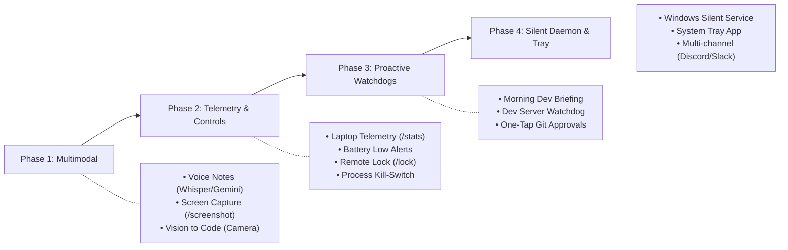

# 🚀 Future Scope & Product Roadmap

This document outlines upcoming capabilities, features, and architectural expansions for the **Telegram Mobile Companion & Remote Dev Assistant**.

---

## 🗺️ Feature Roadmap

---

## 1. 📱 Mobile-Native Superpowers (Voice & Vision)

- [ ] **Voice Notes to Tasks (Audio $\rightarrow$ Action)**
  - Send an audio voice message from Telegram while on the go.
  - Automatically transcribe using OpenAI Whisper or Google Gemini multimodal audio.
  - Execute the transcribed instruction directly within the active workspace.
- [ ] **Camera / Sketch to Code (Multimodal Vision)**
  - Snap a photo of a whiteboard architecture diagram, wireframe sketch, or on-screen UI glitch.
  - Send image to the bot $\rightarrow$ Agent parses the visual elements and drafts corresponding code/components.
- [ ] **On-Demand Remote Screen Capture (`/screenshot`)**
  - Command `/screenshot` takes a snapshot of the primary laptop display (via PIL/mss).
  - Sends the image back to Telegram so you can check running UI apps or test progress remotely.

---

## 2. 💻 Remote Telemetry & Emergency Controls

- [ ] **Laptop Telemetry & Health Monitoring (`/stats`)**
  - Real-time CPU usage, RAM utilization, available disk space, and internal temperatures.
  - Battery charge level and AC power status.
  - Proactive notification if laptop is unplugged and battery drops below 15%.
- [ ] **Process Manager & Emergency Kill-Switch (`/ps` & `/kill`)**
  - View top resource-consuming processes running on the laptop.
  - Emergency command `/kill <pid>` or `/abort` to immediately terminate runaway builds or scripts.
- [ ] **Remote Workstation Lock (`/lock`)**
  - Lock Windows workstation remotely via `rundll32.exe user32.dll,LockWorkStation`.

---

## 3. 🤖 Proactive Workflows & Automated Watchdogs

- [ ] **Daily Morning Standup Briefing (Scheduled at 9:00 AM)**
  - Automated morning summary sent to your phone:
    - Commits made the previous day across `D:\dev`.
    - Dirty working trees and uncommitted local changes.
    - Open GitHub PRs and issues.
- [ ] **Localhost & Dev Server Watchdog**
  - Background health pings to local development endpoints (e.g. `http://localhost:3000`).
  - Automatic push alert if a local dev server crashes or throws unhandled exceptions.
- [ ] **Interactive Git Review & One-Tap Actions**
  - Receive `/git diff` formatted with inline buttons:
    - `[✅ Commit & Push]`
    - `[📦 Stash]`
    - `[❌ Discard Changes]`

---

## 4. ⚙️ Production Resilience & Windows Integration

- [ ] **Silent Windows Background Service**
  - Run the companion as a background Windows service or Task Scheduler task on user login.
  - Eliminates the need to keep a terminal window open.
- [ ] **System Tray Companion**
  - Minimalist Windows tray icon showing connection status, quick pause/resume toggle, and log viewer.
- [ ] **Multi-Channel Frontend Expansion**
  - Extend adapter layer to support **Discord** private channels, **Slack** incoming webhooks, and **WhatsApp** gateways alongside Telegram.

---

## 💡 Contributing & Suggestions
Have an idea or feature request? Open an issue or submit a pull request on the [GitHub Repository](https://github.com/riteshray830/telegram-mobile-companion).
