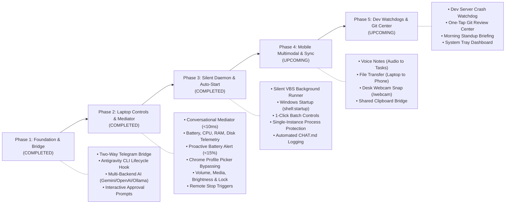

# 🚀 Future Scope & Product Roadmap

This document outlines delivered capabilities, active features, and the forward roadmap for the **Telegram Mobile Companion & Remote Dev Assistant (`Friday`)**.

---

## 🗺️ Feature Roadmap & Progress

---

## 🌟 Delivered Features (Completed)

### 1. 🤖 Two-Way Communication & Antigravity Bridge
- [x] **Telegram FastMCP Server & Companion Runner** ([`server.py`](file:///D:/dev/projects/Antigravity%20remove%20chat%20tool/telegram-companion-mcp/server.py), [`friday_runner.py`](file:///D:/dev/projects/Antigravity%20remove%20chat%20tool/telegram-companion-mcp/friday_runner.py))
- [x] **Antigravity CLI Lifecycle Hook** ([`forward_reply_hook.py`](file:///D:/dev/projects/Antigravity%20remove%20chat%20tool/telegram-companion-mcp/forward_reply_hook.py))
- [x] **Multi-Backend AI Adapter** (Antigravity CLI, Google Gemini, OpenAI, Anthropic Claude, Local Ollama)
- [x] **Interactive Permission Prompts** (`[Approve]`, `[Reject]` inline buttons)

### 2. 🕹️ Conversational Mediator & Laptop Controls
- [x] **Sub-Millisecond Human Mediator** ([`mediator.py`](file:///D:/dev/projects/Antigravity%20remove%20chat%20tool/telegram-companion-mcp/mediator.py)): Handles casual English, Hinglish, and slash commands without slow LLM inference.
- [x] **Battery Health Telemetry & 15% Low Alert Watchdog**: Real-time percentage, charging state, cycles, and health degradation percentage.
- [x] **Performance & Storage Monitoring**: Live CPU usage, RAM utilization, and free disk space per drive.
- [x] **Hardware Laptop Controls** ([`system_controls.py`](file:///D:/dev/projects/Antigravity%20remove%20chat%20tool/telegram-companion-mcp/system_controls.py)):
  - Master Volume (`mute`, `volume up`, `volume down`)
  - Media Playback (`play/pause`, `next song`, `prev song`, `stop`)
  - Screen Brightness (`brightness 0-100%`, `brightness up/down`)
  - Remote Workstation Lock (`lock`, `lock pc`, `lock screen`)
  - Screen Capture & Delivery (`/screenshot`, `ss`)
- [x] **Process Manager & Kill-Switch** (`/ps`, `/kill <PID or name>`)
- [x] **Google Chrome Profile Picker Bypassing** ([`app_launcher.py`](file:///D:/dev/projects/Antigravity%20remove%20chat%20tool/telegram-companion-mcp/app_launcher.py)): Launches directly into specific profiles (`Default`, `Snigdha`, `318`, `566`, `Roy`) with 0ms disk cache.
- [x] **Popular Desktop Apps & Websites**: VS Code, Notepad, Calculator, Explorer, YouTube, GitHub, etc.

### 3. 🚀 Silent Windows Service & Remote Shutdown
- [x] **Windows Auto-Start on Boot** ([`autostart_manager.py`](file:///D:/dev/projects/Antigravity%20remove%20chat%20tool/telegram-companion-mcp/autostart_manager.py)): Installs into `shell:startup` to start silently on boot.
- [x] **Zero-Console Silent Runner** ([`friday_silent_runner.vbs`](file:///D:/dev/projects/Antigravity%20remove%20chat%20tool/friday_silent_runner.vbs)): Windowless execution via `pythonw.exe`.
- [x] **Remote Shutdown Triggers**: `/stop`, `stop friday`, `friday band karo` remotely terminates the daemon cleanly.
- [x] **1-Click Laptop Batch Controls**: [`enable_autostart.bat`](file:///D:/dev/projects/Antigravity%20remove%20chat%20tool/enable_autostart.bat), [`disable_autostart.bat`](file:///D:/dev/projects/Antigravity%20remove%20chat%20tool/disable_autostart.bat), [`status_autostart.bat`](file:///D:/dev/projects/Antigravity%20remove%20chat%20tool/status_autostart.bat), [`start_friday.bat`](file:///D:/dev/projects/Antigravity%20remove%20chat%20tool/start_friday.bat), [`stop_friday.bat`](file:///D:/dev/projects/Antigravity%20remove%20chat%20tool/stop_friday.bat).
- [x] **Automated Activity & Conversation Logging** ([`chat_logger.py`](file:///D:/dev/projects/Antigravity%20remove%20chat%20tool/telegram-companion-mcp/chat_logger.py)): Full conversation synchronized automatically to [`CHAT.md`](file:///D:/dev/projects/Antigravity%20remove%20chat%20tool/CHAT.md) and [`.chat.md`](file:///D:/dev/projects/Antigravity%20remove%20chat%20tool/.chat.md).

---

## 🔮 Upcoming Capabilities (Future Roadmap)

### 1. 🎙️ Mobile-Native Superpowers (Voice & Vision)
- [ ] **Voice Notes to Tasks (Audio $\rightarrow$ Action)**
  - Hold the microphone button on Telegram while on the go.
  - Automatically transcribe `.oga` voice notes via Whisper or Gemini Multimodal audio.
  - Executes intent or generates code directly without typing.
- [ ] **Remote File Explorer & Downloader (Phone $\leftrightarrow$ Laptop)**
  - Request any file: *"send me resume.pdf from Desktop"* $\rightarrow$ Friday delivers the document to Telegram.
  - Send any file or photo from phone $\rightarrow$ Friday automatically saves it to laptop's `Downloads` or project folder.
- [ ] **Desk / Room Security Webcam Snap (`/webcam`)**
  - Command `/webcam` triggers laptop's front webcam, captures a photo, and sends it to Telegram to check on desk or room.
- [ ] **Camera / Sketch to Code (Multimodal Vision)**
  - Snap a photo of a whiteboard diagram or sketch $\rightarrow$ Friday parses visual elements and drafts code.

### 2. 📋 Productivity & System Integrations
- [ ] **Shared Clipboard Bridge (Phone $\leftrightarrow$ Laptop)**
  - Send `"copy: <text>"` from phone $\rightarrow$ instantly copied to Windows clipboard ready to `Ctrl+V`.
  - Ask *"what is copied on my laptop?"* $\rightarrow$ returns laptop clipboard text to Telegram.
- [ ] **Windows Power Controls**:
  - Sleep mode: `"put laptop to sleep"` via `SetSuspendState`.
  - Empty Recycle Bin: `"empty recycle bin"` to free disk space.
  - Safe Restart / Shutdown with confirmation prompt.

### 3. 🔔 Proactive Watchdogs & Git Automation
- [ ] **Localhost & Dev Server Watchdog**
  - Monitor local development ports (e.g. `http://localhost:3000`, `8080`).
  - Send instant push alert to Telegram if a dev server crashes or stops responding.
- [ ] **Remote Git Command Center & Interactive Diff Review**
  - Check status of projects across `D:\dev` remotely.
  - Receive git diffs with interactive inline buttons: `[✅ Commit & Push]`, `[📦 Stash]`, `[📥 Pull Latest]`.
- [ ] **Daily Morning Standup Briefing (9:00 AM)**
  - Automated morning summary of uncommitted changes, yesterday's commits, and pending tasks.

### 4. 🪟 Windows System Tray Companion
- [ ] **Minimalist System Tray Dashboard**
  - Small icon in Windows system tray showing connection status, quick toggle, and log viewer.

---

## 💡 Contributing & Suggestions
Have an idea or feature request? Open an issue or submit a pull request on the [GitHub Repository](https://github.com/riteshray830/telegram-mobile-companion).
