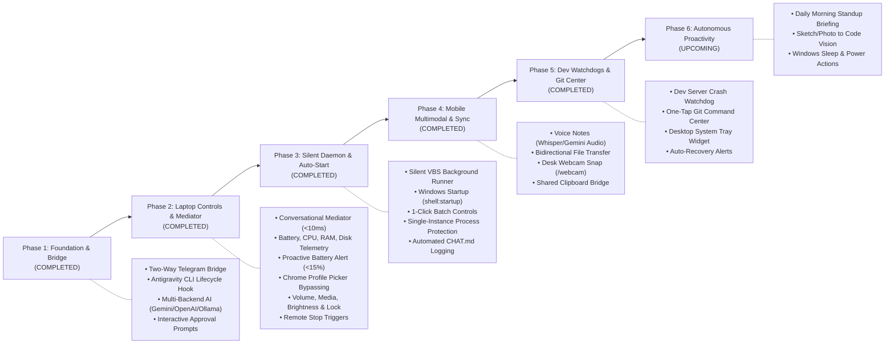

# 🚀 Future Scope & Product Roadmap

This document outlines delivered capabilities, active features, and the forward roadmap for the **Telegram Mobile Companion & Remote Dev Assistant (`Friday`)**.

---

## 🗺️ Feature Roadmap & Progress

---

## 🌟 Delivered Features (Completed)

### 1. 🤖 Two-Way Communication & Antigravity Bridge
- [x] **Telegram FastMCP Server & Companion Runner** ([`server.py`](file:///D:/dev/projects/Antigravity%20remove%20chat%20tool/telegram-companion-mcp/server.py), [`friday_runner.py`](file:///D:/dev/projects/Antigravity%20remove%20chat%20tool/telegram-companion-mcp/friday_runner.py))
- [x] **Antigravity CLI Lifecycle Hook** ([`forward_reply_hook.py`](file:///D:/dev/projects/Antigravity%20remove%20chat%20tool/telegram-companion-mcp/forward_reply_hook.py))
- [x] **Multi-Backend AI Adapter** (Antigravity CLI, Google Gemini, OpenAI, Anthropic Claude, Local Ollama)
- [x] **Interactive Permission Prompts** (`[Approve]`, `[Reject]` inline buttons)

### 2. 🕹️ Conversational Mediator & Laptop Controls
- [x] **Sub-Millisecond Human Mediator** ([`mediator.py`](file:///D:/dev/projects/Antigravity%20remove%20chat%20tool/telegram-companion-mcp/mediator.py)): Handles casual English, Hinglish, and slash commands without slow LLM inference.
- [x] **Battery Health Telemetry & 15% Low Alert Watchdog**: Real-time percentage, charging state, cycles, and health degradation percentage.
- [x] **Performance & Storage Monitoring**: Live CPU usage, RAM utilization, and free disk space per drive.
- [x] **Hardware Laptop Controls** ([`system_controls.py`](file:///D:/dev/projects/Antigravity%20remove%20chat%20tool/telegram-companion-mcp/system_controls.py)):
  - Master Volume (`mute`, `volume up`, `volume down`)
  - Media Playback (`play/pause`, `next song`, `prev song`, `stop`)
  - Screen Brightness (`brightness 0-100%`, `brightness up/down`)
  - Remote Workstation Lock (`lock`, `lock pc`, `lock screen`)
  - Screen Capture & Delivery (`/screenshot`, `ss`)
- [x] **Process Manager & Kill-Switch** (`/ps`, `/kill <PID or name>`)
- [x] **Google Chrome Profile Picker Bypassing** ([`app_launcher.py`](file:///D:/dev/projects/Antigravity%20remove%20chat%20tool/telegram-companion-mcp/app_launcher.py)): Launches directly into specific profiles (`Default`, `Snigdha`, `318`, `566`, `Roy`) with 0ms disk cache.
- [x] **Popular Desktop Apps & Websites**: VS Code, Notepad, Calculator, Explorer, YouTube, GitHub, etc.

### 3. 🚀 Silent Windows Service & Remote Shutdown
- [x] **Windows Auto-Start on Boot** ([`autostart_manager.py`](file:///D:/dev/projects/Antigravity%20remove%20chat%20tool/telegram-companion-mcp/autostart_manager.py)): Installs into `shell:startup` to start silently on boot.
- [x] **Zero-Console Silent Runner** ([`friday_silent_runner.vbs`](file:///D:/dev/projects/Antigravity%20remove%20chat%20tool/friday_silent_runner.vbs)): Windowless execution via `pythonw.exe`.
- [x] **Remote Shutdown Triggers**: `/stop`, `stop friday`, `friday band karo` remotely terminates the daemon cleanly.
- [x] **1-Click Laptop Batch Controls**: [`enable_autostart.bat`](file:///D:/dev/projects/Antigravity%20remove%20chat%20tool/enable_autostart.bat), [`disable_autostart.bat`](file:///D:/dev/projects/Antigravity%20remove%20chat%20tool/disable_autostart.bat), [`status_autostart.bat`](file:///D:/dev/projects/Antigravity%20remove%20chat%20tool/status_autostart.bat), [`start_friday.bat`](file:///D:/dev/projects/Antigravity%20remove%20chat%20tool/start_friday.bat), [`stop_friday.bat`](file:///D:/dev/projects/Antigravity%20remove%20chat%20tool/stop_friday.bat).
- [x] **Automated Activity & Conversation Logging** ([`chat_logger.py`](file:///D:/dev/projects/Antigravity%20remove%20chat%20tool/telegram-companion-mcp/chat_logger.py)): Full conversation synchronized automatically to [`CHAT.md`](file:///D:/dev/projects/Antigravity%20remove%20chat%20tool/CHAT.md) and [`.chat.md`](file:///D:/dev/projects/Antigravity%20remove%20chat%20tool/.chat.md).

### 4. 🎙️ Mobile-Native Superpowers (Voice, Vision & Files)
- [x] **Voice Notes to Tasks (Audio $\rightarrow$ Action)** ([`voice_handler.py`](file:///D:/dev/projects/Antigravity%20remove%20chat%20tool/telegram-companion-mcp/voice_handler.py)):
  - Send voice notes (`.oga`/`.ogg`) directly in Telegram.
  - Automatically transcribed via Gemini 2.5 Flash native multimodal audio or OpenAI Whisper API.
  - Dispatches transcribed audio commands immediately as live laptop actions.
- [x] **Desk / Room Security Webcam Snap (`/webcam`)** ([`webcam_snap.py`](file:///D:/dev/projects/Antigravity%20remove%20chat%20tool/telegram-companion-mcp/webcam_snap.py)):
  - Remote camera snap via DirectShow backend (`cv2.CAP_DSHOW`) delivering immediate desk/room photo to Telegram.
- [x] **Remote File Transfer (Phone $\leftrightarrow$ Laptop)** ([`file_transfer.py`](file:///D:/dev/projects/Antigravity%20remove%20chat%20tool/telegram-companion-mcp/file_transfer.py)):
  - **Download from Laptop:** `download <file>`, `send me <file>`, `/file <path>` quickly searches `D:\dev`, Desktop, and Downloads with directory pruning and sends file via Telegram `sendDocument`.
  - **Upload to Laptop:** Sending any document or file to Telegram automatically saves it into `Downloads\TelegramUploads` with automatic deduplication.
- [x] **Shared Clipboard Bridge** ([`clipboard_bridge.py`](file:///D:/dev/projects/Antigravity%20remove%20chat%20tool/telegram-companion-mcp/clipboard_bridge.py)):
  - `copy: <text>` or `/copy <text>`: Instantly writes text to laptop clipboard ready for `Ctrl+V`.
  - `/clip` or `clipboard`: Reads current text on laptop clipboard and displays it on mobile.

### 5. 🔔 Proactive Watchdogs, Git Center & Tray Widget
- [x] **Dev Server Crash Watchdog** ([`dev_watchdog.py`](file:///D:/dev/projects/Antigravity%20remove%20chat%20tool/telegram-companion-mcp/dev_watchdog.py)):
  - `/watch <port or url>`: Proactively pings local server every 15 seconds.
  - Alerts phone on crash (connection refused / 500 error) after 2 failed pings.
  - Sends recovery celebration message when server comes back online.
  - `/watchers`: Lists all monitored local endpoints.
  - `/unwatch <port>`: Stops watching endpoint.
- [x] **Remote Git Command Center** ([`git_center.py`](file:///D:/dev/projects/Antigravity%20remove%20chat%20tool/telegram-companion-mcp/git_center.py)):
  - `/git` or `git status`: Reports branch name, dirty working tree files, and latest commit.
  - Inline Telegram buttons: `[✅ Commit & Push]`, `[📦 Stash]`, `[🔍 View Diff]`, `[📥 Pull Latest]`.
- [x] **Windows System Tray Companion** ([`system_tray.py`](file:///D:/dev/projects/Antigravity%20remove%20chat%20tool/telegram-companion-mcp/system_tray.py)):
  - Minimalist glowing 'F' taskbar tray widget (`pystray`).
  - Menu options: View chat log (`CHAT.md`), Open `D:\dev`, Toggle boot auto-start, Restart Friday daemon, and Stop Friday daemon.
  - 1-Click Launchers: [`start_tray.bat`](file:///D:/dev/projects/Antigravity%20remove%20chat%20tool/start_tray.bat) and [`friday_tray_runner.vbs`](file:///D:/dev/projects/Antigravity%20remove%20chat%20tool/friday_tray_runner.vbs).

---

## 🔮 Upcoming Capabilities (Future Roadmap)

### 1. 👁️ Advanced Multimodal Vision
- [ ] **Camera / Sketch to Code**
  - Snap a photo of a whiteboard diagram or UI mockup $\rightarrow$ Friday parses layout elements and drafts corresponding code.
- [ ] **Dual-Screen & Multi-Monitor Switching**
  - Ability to choose which monitor to screenshot or switch active window displays.

### 2. ⚡ Extended Windows Power Actions
- [ ] **Windows Sleep & Hibernation**
  - `"put laptop to sleep"` via `SetSuspendState`.
- [ ] **Empty Recycle Bin**
  - `"empty recycle bin"` to free disk space remotely.
- [ ] **Safe Restart / Shutdown with Confirmation**
  - Prompts with interactive Telegram confirmation before rebooting Windows.

### 3. 🌅 Autonomous Morning Standup Briefing
- [ ] **Daily Morning Standup (9:00 AM)**
  - Automated morning push summary of uncommitted changes, yesterday's commits, and pending tasks.

---

## 💡 Contributing & Suggestions
Have an idea or feature request? Open an issue or submit a pull request on the [GitHub Repository](https://github.com/riteshray830/telegram-mobile-companion).
