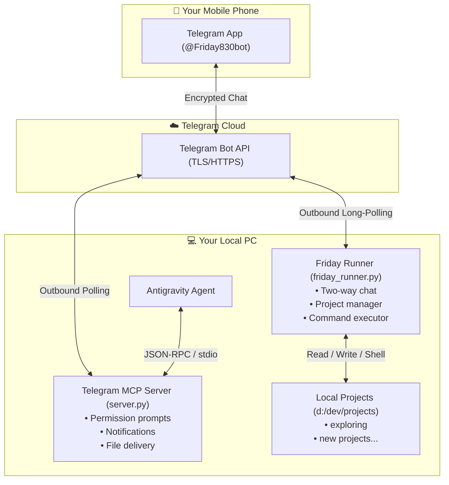

# 📱 Telegram Mobile Companion & Remote Dev Assistant

A wireless bridge connecting **Antigravity** and your local development workspace directly to your mobile phone via Telegram.

---

## 🌟 Capabilities

1. **Two-Way Remote Chat**: Chat with your local workspace assistant on the go from your phone.
2. **Project Management from Mobile**:
   - **Find & List Projects**: View all projects under `d:\dev\projects` with type detection and status.
   - **Create Projects**: One-tap scaffolding for Python, Node.js, and Web projects with Git initialization.
   - **Switch Active Project**: Select your active working project context remotely.
3. **Remote Code Inspection & Editing**:
   - Browse directory trees (`/ls`).
   - Deep search for files across projects (`/find`).
   - Read code and logs on mobile (`/read`).
   - Write and edit files remotely (`/write`).
4. **Shell & Git Command Execution**:
   - Run any command on your PC (`/run npm test`, `/run python script.py`, etc.).
   - Quick Git workflows (`/git status`, `/git diff`, `/git commit`).
5. **Agent Permission & Approvals (MCP)**:
   - Interactive `[Approve]` and `[Reject]` inline buttons sent to your phone before dangerous agent operations.
   - Auto-expiring prompts with a strict **fail-safe default-to-deny** policy.
6. **Live Notifications**:
   - Real-time build alerts, test suite completions, and error notifications.

---

## 🏗️ Architecture



> [!NOTE]
> **Zero Public Inbound Ports**: The bridge uses Telegram outbound long-polling (`getUpdates`). You never need to open router ports, configure port forwarding, or expose your PC to the public internet.

---

## 📋 Command Cheat Sheet

### 📂 Projects & Navigation
| Command | Example | Description |
| :--- | :--- | :--- |
| `/projects` | `/projects` | Lists all projects with interactive buttons to switch context. |
| `/cd <name>` | `/cd exploring` | Switches active project to the specified directory. |
| `/create <type> <name>` | `/create python my-bot` | Scaffolds a new project (`python`, `node`, `web`). |
| `/status` | `/status` | Displays PC connection, active project, and disk info. |

### 🔍 Code & Files
| Command | Example | Description |
| :--- | :--- | :--- |
| `/ls [dir]` | `/ls` or `/ls src` | Lists directory contents with sizes. |
| `/find <pattern>` | `/find *.py` or `/find test` | Recursively searches for files matching a pattern. |
| `/read <file>` | `/read main.py` | Displays file code in formatted markdown or sends as doc if large. |
| `/write <file>` | `/write hello.txt` | Writes the following text lines directly into a file. |

### ⚙️ Terminal & Git
| Command | Example | Description |
| :--- | :--- | :--- |
| `/run <command>` | `/run pytest` | Executes a shell command on PC and returns formatted terminal output. |
| `/git <args>` | `/git status` or `/git diff` | Runs git commands inside the active project. |
| `/help` | `/help` | Shows full help menu. |

---

## 🚀 Setup & Installation Guide

### Prerequisites
- Python 3.10+ (tested on Python 3.13)
- `uv` (optional, but recommended)

### 1. Telegram Bot Creation
1. Open Telegram on your phone and start a chat with **`@BotFather`**.
2. Send `/newbot`, name your bot (e.g. `Friday`), and choose a username ending in `bot` (e.g. `Friday830bot`).
3. Copy the **Bot Token** provided.

### 2. Configuration (`.env`)
Create a `.env` file in `telegram-companion-mcp/`:
```env
TELEGRAM_BOT_TOKEN="your_bot_token_here"
TELEGRAM_CHAT_ID="your_numeric_user_id_here"
PROJECTS_ROOT="d:\dev\projects"
# Optional: Add Google AI Studio key for free-form Gemini conversational reasoning:
# GEMINI_API_KEY="AIzaSy..."
```

### 3. Running the Assistant
- **Quick Double-Click**: Run [`start_friday.bat`](file:///d:/dev/projects/exploring/telegram-companion-mcp/start_friday.bat).
- **Or via Command Line**:
  ```powershell
  python -u d:\dev\projects\exploring\telegram-companion-mcp\friday_runner.py
  ```

### 4. Antigravity MCP Server Integration
To allow the Antigravity agent to send permission buttons and notifications to your phone:

In `~/.gemini/config/mcp_config.json`:
```json
{
  "mcpServers": {
    "telegram-companion": {
      "command": "python",
      "args": [
        "d:/dev/projects/exploring/telegram-companion-mcp/server.py"
      ],
      "env": {
        "TELEGRAM_BOT_TOKEN": "YOUR_BOT_TOKEN",
        "TELEGRAM_CHAT_ID": "YOUR_CHAT_ID"
      }
    }
  }
}
```

---

## 🔒 Security & Privacy Rules

1. **User ID Whitelisting**: Every incoming message, tap, or callback verifies `sender_id == TELEGRAM_CHAT_ID`. Unrecognized users are discarded immediately.
2. **Fail-Safe Approvals**: Permission requests time out (default 120s) and automatically default to **Deny**.
3. **Credential Isolation**: `.env` is listed in `.gitignore` and must never be committed to source control.

